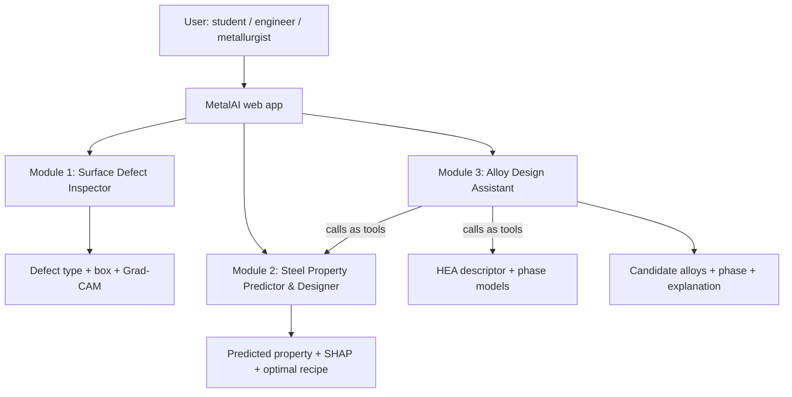
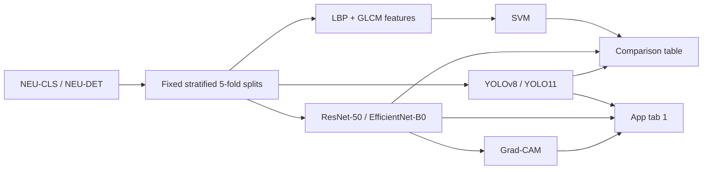
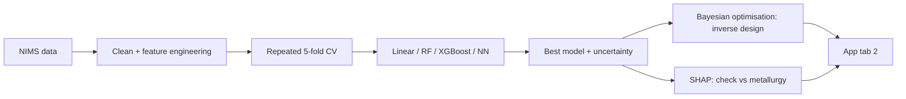
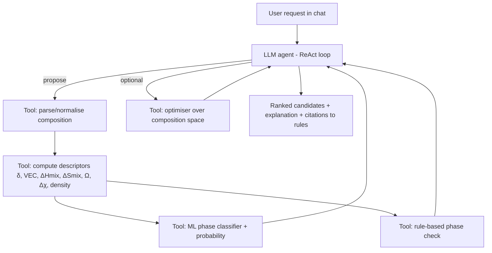

# MetalAI — Project Guide

> **MetalAI**: an AI toolkit for metallurgists — inspect steel surfaces, predict and design steel properties, and explore new alloys with an AI assistant.
>
> **Audience:** team members. Read this end to end before writing code.
> **Type:** M.Tech project (MTP). We **reimplement and integrate published methods** — originality is not the goal; correctness, reproducibility, metallurgical interpretation, and a working app are.

---

## Table of contents

1. [TL;DR](#1-tldr)
2. [Background — why we restarted](#2-background--why-we-restarted)
3. [What MetalAI is](#3-what-metalai-is)
4. [Metallurgy + ML primer](#4-metallurgy--ml-primer)
5. [Module 1 — Surface Defect Inspector](#5-module-1--surface-defect-inspector)
6. [Module 2 — Steel Property Predictor & Designer](#6-module-2--steel-property-predictor--designer)
7. [Module 3 — Alloy Design Assistant (HEA + LLM agent)](#7-module-3--alloy-design-assistant-hea--llm-agent)
8. [The MetalAI web app](#8-the-metalai-web-app)
9. [Repository structure & tech stack](#9-repository-structure--tech-stack)
10. [Evaluation rules (everyone follows)](#10-evaluation-rules-everyone-follows)
11. [Mistakes we must not repeat](#11-mistakes-we-must-not-repeat)
12. [Timeline & ownership](#12-timeline--ownership)
13. [Future extensions](#13-future-extensions)
14. [Glossary](#14-glossary)
15. [References](#15-references)

---

## 1. TL;DR

MetalAI has **three modules** sharing one web app:

| # | Module | Input → Output | Data | Core methods |
|---|---|---|---|---|
| 1 | **Surface Defect Inspector** | Photo of steel surface → defect type, location (box), heatmap | NEU-CLS, NEU-DET | LBP+GLCM+SVM, CNN (ResNet/EfficientNet), YOLO, Grad-CAM |
| 2 | **Steel Property Predictor & Designer** | Composition + heat treatment → fatigue strength (and other properties); target property → suggested recipe | NIMS steel fatigue dataset | Gradient boosting / RF / NN, SHAP, Bayesian optimisation |
| 3 | **Alloy Design Assistant** | Chat request ("single-phase BCC HEA without Co") → candidate compositions + predicted phase + reasoning | HEA phase datasets | Hume-Rothery descriptors (δ, VEC, ΔHmix, ΔSmix, Ω), XGBoost classifier, LLM tool-calling agent |

**Golden rule:** every number in the thesis must be reproducible from code in the repo.

---

## 2. Background — why we restarted

A previous MTP (IIT KGP, 2025; repo `Akshaay1/metal-defect-detector`) tackled surface defect classification and claimed a 5-model ensemble with 96.4% accuracy. Our audit found:

- **No data and no training/evaluation code** in the repo (scripts listed in README don't exist).
- **The "ensemble" reads the class from the uploaded filename** and returns it with 100% confidence (label leakage).
- Segmentation models trained without masks; "texture network" contained no texture features; broken ArcFace and SimCLR code; classical baseline missing; training page faked with `Math.random()`.
- Thesis inconsistent with code (class counts, "No Defect" class, dataset description).

**Decision:** keep the problem idea, rebuild from scratch, and broaden into MetalAI (Modules 2 and 3) so the project covers more metallurgy than image classification alone.

---

## 3. What MetalAI is



### Problem statements (simple)

1. **Inspection:** Human inspection of steel surfaces is slow and inconsistent. *Can a vision model find and name surface defects and show its evidence?*
2. **Property prediction & design:** Testing fatigue strength takes weeks. *Can we predict it from composition and heat treatment, explain which factors matter, and suggest recipes that hit a target?*
3. **Alloy exploration:** High-entropy alloys have a huge composition space. *Can an AI assistant use metallurgical rules plus ML to propose compositions likely to form a desired phase?*

### Why this impresses (and is defensible)

- Covers the **processing → structure → property → performance** chain metallurgists care about.
- **Interpretability checked against theory** (SHAP vs known effects of C, tempering, Hume-Rothery rules).
- **Working demo** for all three.
- Reimplementations with **side-by-side comparison to the original papers**.

---

## 4. Metallurgy + ML primer

### 4.1 Metallurgy concepts used

| Concept | Where used | One-line meaning |
|---|---|---|
| Surface defects (crazing, inclusion, patches, pitted surface, rolled-in scale, scratches) | M1 | Flaws formed during hot rolling/handling of steel strip |
| Texture | M1 | Defects are mostly local texture changes → LBP/GLCM/Gabor features |
| Alloying elements (C, Si, Mn, Cr, Ni, Mo, Cu, P, S) | M2 | Control hardenability, strength, toughness; P/S usually harmful |
| Heat treatment (normalising, quench/through-hardening, tempering, carburising) | M2 | Controls microstructure (ferrite/pearlite/martensite/tempered martensite) |
| Tempering | M2 | Higher tempering temperature → lower strength/hardness, higher toughness |
| Non-metallic inclusions | M2 | Crack initiation sites → lower fatigue strength |
| Fatigue strength | M2 | Max stress amplitude a material survives for ~10⁷ cycles |
| High-entropy alloys (HEAs / MPEAs) | M3 | ≥4–5 principal elements in near-equal amounts |
| Hume-Rothery-type rules | M3 | Size mismatch, electron concentration, mixing enthalpy decide phase formation |
| Phases: FCC, BCC, FCC+BCC, intermetallic (IM), amorphous | M3 | Crystal structure outcome of an HEA |

### 4.2 HEA descriptors (Module 3 core)

For an alloy with elements *i*, atomic fractions *cᵢ*, radii *rᵢ*:

| Descriptor | Formula | Typical rule |
|---|---|---|
| Atomic size mismatch **δ** | δ = 100·√(Σ cᵢ(1 − rᵢ/r̄)²), r̄ = Σ cᵢrᵢ | Solid solution usually δ ≤ ~6.6% |
| Mixing entropy **ΔS_mix** | −R Σ cᵢ ln cᵢ | Higher → favours solid solution |
| Mixing enthalpy **ΔH_mix** | Σ_{i<j} 4·ΔH_ij·cᵢcⱼ (binary values from Takeuchi–Inoue / Miedema table) | Near 0 (≈ −15 to +5 kJ/mol) → solid solution |
| **Ω** | T_m·ΔS_mix / \|ΔH_mix\|, T_m = Σ cᵢT_m,i | Ω ≥ 1.1 → solid solution favoured |
| Valence electron concentration **VEC** | Σ cᵢ·VECᵢ | VEC ≥ 8 → FCC; VEC < 6.87 → BCC; between → mixed |
| Electronegativity difference **Δχ** | √(Σ cᵢ(χᵢ − χ̄)²) | Large → intermetallics more likely |

These rules give a **physics baseline**; the ML model should beat it, and SHAP on the ML model should rediscover these rules.

### 4.3 ML concepts used

| Concept | Where | Meaning |
|---|---|---|
| SVM | M1 | Classical classifier on handcrafted features |
| CNN + transfer learning | M1 | Fine-tune ImageNet-pretrained ResNet/EfficientNet |
| YOLO | M1 | One-stage detector → boxes + class + confidence |
| Grad-CAM | M1 | Heatmap of pixels that drove the CNN's decision |
| Random forest / gradient boosting (XGBoost, LightGBM) | M2, M3 | Strong models for small tabular data |
| SHAP | M2, M3 | Shows how much each input feature pushed a prediction up/down |
| Bayesian optimisation | M2 | Efficient search for inputs that maximise/minimise a model output |
| Uncertainty (ensembles / quantile models) | M2 | "How sure is the prediction?" — important for design |
| LLM tool calling / ReAct agent | M3 | An LLM that reasons, calls our Python tools, reads results, iterates |

### 4.4 What Grad-CAM is (short)

When a CNN predicts "scratch", Grad-CAM computes how strongly each feature map in the last conv layer influenced that score (via gradients), takes a weighted sum, and overlays it as a heatmap: red = "looked here". Useful for trust and for catching shortcut learning. It is coarse; we show raw heatmaps and (later) measure them.

### 4.5 What SHAP is (short)

For one prediction, SHAP splits "prediction − average prediction" into contributions per feature (e.g., "tempering temp = 650 °C lowered fatigue strength by 80 MPa"). Over the whole dataset, it ranks feature importance and shows the direction of each effect. We use it to check the model **agrees with metallurgy**.

---

## 5. Module 1 — Surface Defect Inspector

### 5.1 Goal

Photo of a hot-rolled steel strip surface → **defect class + bounding box + Grad-CAM**, with a fair comparison of classical vs deep methods.

### 5.2 Data

| Dataset | Content | Labels | Use |
|---|---|---|---|
| **NEU-CLS** | 1,800 grayscale 200×200 images, 6 classes × 300 | Class per image | Classification |
| **NEU-DET** | Same images | Bounding boxes (Pascal VOC XML) | Detection |
| GC10-DET (later) | ~2,300 real-production images, 10 classes | Boxes | Robustness test (future) |

Classes: crazing, inclusion, patches, pitted surface, rolled-in scale, scratches.
Download from Kaggle mirrors (official NEU site often down). Record source URL, date, checksum in `data/README.md`. ⚠️ Verify counts after download.

### 5.3 Pipeline



### 5.4 Steps

**Step 1 — Data (1–2 days)**
- Download to `data/raw/neu/`. EDA notebook: class counts, sample grid, intensity histograms, box sizes.
- `make_splits.py`: stratified 5-fold, seed 42 → `data/splits/neu_folds.csv` (`filename,label,fold`). Same folds for NEU-DET.
- `voc_to_yolo.py`: VOC XML → YOLO txt; write `configs/neu_det.yaml`.

**Step 2 — Classical baseline (2–3 days)**
- LBP: `local_binary_pattern(P=8, R∈{1,2,3}, method='uniform')` → concatenated histograms.
- GLCM: distances {1,2,3}, angles {0,45,90,135}° → contrast, dissimilarity, homogeneity, energy, correlation, ASM.
- `StandardScaler` + `SVC(rbf)`, tune `C`, `gamma` inside training folds only.
- Ablation: LBP only / GLCM only / both.

**Step 3 — CNN classifier (3–4 days)**
- ResNet-50 and EfficientNet-B0, ImageNet weights, 6-class head.
- Gray → 3 channels, resize 224, **ImageNet normalisation in one shared `preprocess()` used everywhere**.
- Train-only augmentation: flips, ±10° rotation, mild brightness/contrast.
- AdamW, lr 1e-4, cosine schedule, ~30 epochs, early stopping on val loss; 5 folds.
- Grad-CAM via `pytorch-grad-cam`, target `layer4[-1]`; save correct + failure examples. No extra contrast tricks.

**Step 4 — YOLO detector (3–4 days)**
```bash
yolo detect train data=configs/neu_det.yaml model=yolov8n.pt imgsz=640 epochs=150 patience=30 seed=42
yolo detect val   data=configs/neu_det.yaml model=runs/detect/train/weights/best.pt
```
Report mAP@0.5, mAP@0.5:0.95, per-class AP, FPS.

### 5.5 Reference numbers (what papers report)

| Task | Literature | Our target |
|---|---|---|
| NEU-CLS classification | 98–100% (DenseNet201 ≈ 98.4%) | Match within ~1–2%, report mean ± std |
| LBP/GLCM + SVM | (varies) | Honest baseline, likely 85–95% |
| NEU-DET YOLOv8n | ≈ 73% mAP@0.5; improved YOLOs 77–86% | ≈ 70–75% mAP@0.5 |

### 5.6 Deliverables

- Results table (SVM vs CNNs vs YOLO), confusion matrices, Grad-CAM grid, detection examples.
- Saved weights; app tab 1.

---

## 6. Module 2 — Steel Property Predictor & Designer

### 6.1 Goal

1. **Predict** fatigue strength (and, if available, tensile strength, fracture strength, hardness) of carbon/low-alloy steels from **composition + processing**.
2. **Explain** the model with SHAP and check against metallurgy.
3. **Design**: given a target (e.g., fatigue strength ≥ X MPa, minimise alloy cost), search for composition + heat-treatment recipes using the model.

### 6.2 Paper(s) we reimplement

- **Agrawal et al. (2014)**, *Integrating Materials and Manufacturing Innovation* — NIMS fatigue data; compared regression methods; feature ranking.
- **Xiong, Zhang & Shi (2020)**, arXiv 2003.01943 — 360 NIMS samples, 4 properties; random forest best; symbolic regression; tempering temperature and carbon among key features.

We reproduce their setup, then add SHAP, uncertainty, and inverse design.

### 6.3 Data — NIMS steel fatigue dataset

- Source: NIMS MatNavi fatigue data sheets; cleaned versions used by the papers above circulate as supplementary data / public mirrors (search "NIMS fatigue dataset 437"). ⚠️ Verify exact source, licence, and column list on download.
- Size: roughly 360–440 steels (depends on version).
- Typical columns (verify):
  - **Composition (wt%)**: C, Si, Mn, P, S, Ni, Cr, Cu, Mo
  - **Processing**: normalising temp, through-hardening temp/time, cooling rate, carburising temp/time, diffusion temp/time, quenching-media temp, tempering temp/time, tempering cooling rate, reduction ratio
  - **Inclusions**: area fractions of inclusion types (dA, dB, dC)
  - **Targets**: fatigue strength (10⁷ cycles, rotating bending); in some versions tensile strength, fracture strength, hardness
- Steel categories inside: carbon steels, low-alloy steels, carburised steels, spring steels — **keep a `steel_type` column** for grouped analysis.

### 6.4 Pipeline



### 6.5 Steps

**Step 1 — Data & EDA (2 days)**
- Load, check units, missing values, duplicates (same steel tested twice → keep in same fold).
- Correlation heatmap; distributions per steel type.
- Engineered features (optional, physics-motivated): **carbon equivalent** CE = C + Mn/6 + (Cr+Mo+V)/5 + (Ni+Cu)/15; flags for carburised / not; total alloy content.

**Step 2 — Forward models (3–4 days)**
- Baselines: mean predictor, linear/ridge regression.
- Models: Random Forest, XGBoost/LightGBM, small MLP, (optional) Gaussian Process.
- **Repeated 5-fold CV** (e.g., 5×5). Metrics: R², RMSE, MAE (MPa). Also report per steel type.
- Compare to papers' reported R² (side-by-side table).

**Step 3 — Uncertainty (1–2 days)**
- RF: spread across trees; or XGBoost quantile regression; or ensemble of 5 seeds.
- Report calibration: % of test points inside predicted 90% interval.

**Step 4 — SHAP interpretation (2 days)**
- `shap.TreeExplainer` on the best tree model.
- Global: beeswarm + bar plot. Local: waterfall for example steels.
- **Metallurgy checks** (write each as pass/fail in the thesis):
  - Tempering temperature ↑ → fatigue strength ↓ (for quenched & tempered steels)?
  - Carbon ↑ → strength ↑ (within range)?
  - Inclusion fraction ↑ → fatigue strength ↓?
  - Carburising → higher surface fatigue strength?
  - Cr/Mo/Ni effects via hardenability?

**Step 5 — Inverse design (3–4 days)**
- Search space: bounded composition + processing ranges taken from the dataset's min/max (don't extrapolate wildly).
- Objective examples:
  - Maximise fatigue strength.
  - Fatigue strength ≥ target while minimising **alloy cost index** (simple per-element price × wt%).
  - Penalise high uncertainty (stay in-distribution).
- Method: `scikit-optimize` / `optuna` (TPE or GP-based Bayesian optimisation); compare with random search.
- **Validation without a lab:** hold out the top-strength steels, train on the rest, check whether the optimiser's suggestions move toward the held-out recipes; also check suggestions with SHAP for physical sense.

### 6.6 Deliverables

- Model comparison table (ours vs papers), parity plots (predicted vs actual), SHAP plots, metallurgy-check table, optimisation results.
- App tab 2: sliders → live prediction + uncertainty + SHAP waterfall; "Design" form → top-5 recipes.

---

## 7. Module 3 — Alloy Design Assistant (HEA + LLM agent)

### 7.1 Goal

A chat assistant that, for a request like *"Suggest a single-phase BCC HEA from refractory elements without Co, density below 10 g/cm³"*:
1. Proposes candidate compositions,
2. Computes metallurgical descriptors (δ, VEC, ΔH_mix, ΔS_mix, Ω, Δχ),
3. Predicts the phase with an ML classifier (+ rule-based check),
4. Iterates until candidates satisfy the request,
5. Explains its reasoning in metallurgical terms.

### 7.2 Paper(s) we reimplement

- **HEA phase prediction with ML on Hume-Rothery-type descriptors** — many papers; we follow the standard descriptor set (Guo/Yang rules) + tree models.
- **"From Phase Prediction to Phase Design: A ReAct Agent Framework for High-Entropy Alloy Discovery"** (arXiv 2603.11068, 2026) — LLM agent + XGBoost surrogate trained on 4,753 experimental records; benchmarked vs Bayesian optimisation and random search.

### 7.3 Data

| Dataset | Content | Notes |
|---|---|---|
| HEA / MPEA phase datasets (e.g., the GitHub dataset cited in the 2026 review: 11,252 entries → 5,692 after cleaning; Borg et al. 2020 *Scientific Data* MPEA dataset) | Composition → observed phase (FCC, BCC, FCC+BCC, IM, amorphous); some with mechanical properties | ⚠️ Verify source, licence, de-duplication |
| Element property table | Atomic radius, VEC, electronegativity, melting point, density, price | Build once in `data/elements.csv` (cite source) |
| Binary mixing enthalpy table | ΔH_ij for element pairs | Takeuchi & Inoue (2005) Miedema-based values |

### 7.4 Pipeline



### 7.5 Steps

**Step 1 — Data & descriptors (3 days)**
- Clean dataset: normalise formulas (e.g., `AlCoCrFeNi`, `Al0.5CoCrFeNi`), convert to atomic fractions, merge duplicates (majority label or drop conflicts), map labels to {FCC, BCC, FCC+BCC, IM, AM}.
- Implement `descriptors.py` (formulas in §4.2) with unit tests against values published for well-known alloys (e.g., CoCrFeMnNi Cantor alloy: FCC, VEC = 8.0).

**Step 2 — Phase classifiers (3 days)**
- Baseline: rule-based classifier (δ, Ω, VEC thresholds).
- ML: Random Forest, XGBoost, (optional) small NN, on descriptors (+ optionally raw fractions).
- **Group-aware CV**: alloys of the same element system (e.g., all Al–Co–Cr–Fe–Ni variants) stay in the same fold, otherwise accuracy is inflated.
- Metrics: accuracy, macro-F1, confusion matrix; compare to reported values.
- SHAP: does the model rediscover VEC → FCC/BCC and δ/Ω → solid solution vs IM?

**Step 3 — Tools (2 days)**
- Wrap as plain Python functions with JSON input/output:
  - `compute_descriptors(composition)`
  - `predict_phase(composition)` → probabilities
  - `rule_check(composition)`
  - `estimate_density(composition)`, `estimate_cost(composition)`
  - `search_compositions(elements, constraints, target_phase, n)` → optimiser / random search over the allowed space
  - (bridge) `predict_steel_property(...)` from Module 2 for steel questions

**Step 4 — LLM agent (4–5 days)**
- Framework: plain function-calling loop (simplest), or LangChain / LlamaIndex.
- LLM: any tool-calling model (hosted API, or a local open model via Ollama if no API budget).
- System prompt: role = alloy design assistant; must call tools for every number; must not invent data; must state uncertainty.
- ReAct loop: think → call tool → observe → refine → answer (max N steps).
- Log every tool call (for the thesis and for debugging).

**Step 5 — Evaluation (3 days)**
- **Tool correctness:** unit tests.
- **Rediscovery test (from the 2026 paper):** hide known alloys of a target phase from the classifier's training set; ask the agent to design that phase; measure how many hidden alloys (or close compositions) it proposes. Compare with random search and Bayesian optimisation.
- **Constraint satisfaction:** % of agent proposals that satisfy all user constraints.
- **Hallucination check:** % of numbers in answers that came from tool outputs.

### 7.6 Deliverables

- Classifier comparison table, SHAP plots, rediscovery results vs baselines, example agent transcripts.
- App tab 3: chat interface with visible tool calls and a results table.

---

## 8. The MetalAI web app

### 8.1 Layout

| Tab | Content |
|---|---|
| **Home** | What MetalAI is, links to modules |
| **1 · Surface Inspector** | Upload image → YOLO boxes, CNN top-3, Grad-CAM, defect description (reference text) |
| **2 · Steel Designer** | Predict: sliders for composition + processing → property ± uncertainty + SHAP waterfall. Design: target + constraints → top-5 recipes |
| **3 · Alloy Assistant** | Chat; shows tool calls, descriptor table, phase probabilities |
| **About** | Datasets, papers reimplemented, model cards (metrics, limits) |

### 8.2 Tech

- **Gradio** (`gr.Blocks` with `gr.Tab`) — fastest; or **Streamlit**. Flask only if we need custom UI.
- Models loaded once at startup; preprocessing imported from the same modules used in training.
- Deploy: local + optional Hugging Face Spaces for the demo.

### 8.3 Hard rules

- Models see only their inputs (pixels / numbers). **No filename or hidden-field shortcuts.**
- Low confidence → "uncertain, manual review".
- Every tab shows a short **model card**: data, metric, known limitations.

---

## 9. Repository structure & tech stack

```
metalai/
├── README.md
├── requirements.txt
├── configs/
├── data/
│   ├── README.md              # sources, dates, checksums, licences
│   ├── raw/                   # untouched downloads (gitignored)
│   ├── processed/
│   ├── splits/                # committed fold files
│   ├── elements.csv           # element properties (cited)
│   └── mixing_enthalpy.csv    # binary ΔH_ij table (cited)
├── notebooks/
│   ├── m1_eda.ipynb
│   ├── m2_eda.ipynb
│   └── m3_eda.ipynb
├── src/metalai/
│   ├── common/                # seed, metrics, logging, results writer
│   ├── m1_surface/
│   │   ├── data.py  splits.py  voc_to_yolo.py
│   │   ├── classical.py       # LBP, GLCM, SVM
│   │   ├── cnn.py  gradcam.py
│   │   └── yolo.py
│   ├── m2_steel/
│   │   ├── data.py  features.py
│   │   ├── models.py  uncertainty.py
│   │   ├── explain.py         # SHAP
│   │   └── design.py          # Bayesian optimisation
│   └── m3_alloy/
│       ├── composition.py     # parsing, normalising
│       ├── descriptors.py     # δ, VEC, ΔH, ΔS, Ω, Δχ
│       ├── classifier.py
│       ├── tools.py           # JSON-in/JSON-out tools
│       └── agent.py           # LLM loop
├── tests/                     # descriptor + tool unit tests
├── models/                    # weights (gitignored)
├── results/                   # CSVs + figures (committed)
└── app/
    └── app.py
```

| Purpose | Library |
|---|---|
| Deep learning | PyTorch, torchvision / timm |
| Detection | ultralytics |
| Classical CV | scikit-image, OpenCV |
| Tabular ML | scikit-learn, XGBoost / LightGBM |
| Explainability | pytorch-grad-cam, shap |
| Optimisation | optuna or scikit-optimize |
| Materials helpers | pymatgen (element data, formula parsing) |
| LLM agent | provider SDK with tool calling, or LangChain; Ollama for local models |
| App | Gradio (or Streamlit) |
| Compute | Colab / Kaggle GPU for M1; laptop CPU is enough for M2, M3 |

---

## 10. Evaluation rules (everyone follows)

1. **Split first, augment/tune second.** Test folds never touched during training or tuning.
2. **Fixed splits** saved in `data/splits/`, shared by all models in a module.
3. **Group-aware splits** where needed: same steel (M2) or same alloy system (M3) never in both train and test.
4. Report **mean ± std** over folds; per-class / per-group metrics.
5. **One preprocessing / feature function** shared by training, evaluation, and app.
6. Every result row in `results/*.csv` includes **date, model, fold, metrics, git commit**.
7. Tables in the thesis are **generated from CSVs**, never typed by hand.
8. For each reimplemented paper: a **"paper vs ours"** table with notes on differences.
9. LLM agent: all numbers in answers must come from tool calls (logged).

---

## 11. Mistakes we must not repeat

| Seen in old project | Our rule |
|---|---|
| Ensemble read label from filename | Inference path code-reviewed; models see inputs only |
| Models claimed but not implemented | If it's in the thesis, a script produces it |
| Segmentation without masks | Only train tasks we have labels for |
| Train/inference preprocessing mismatch | Shared preprocessing module |
| Faked training curves | UI shows real logs or nothing |
| Inconsistent dataset story | `data/README.md` is the single source of truth |
| Over-processed heatmaps | Raw Grad-CAM only |
| Numbers without code/logs | CSV row + commit hash for every number |
| (new risk) LLM inventing numbers | Agent must cite tool outputs; hallucination check in evaluation |
| (new risk) Leakage between similar alloys/steels | Group-aware CV |

---

## 12. Timeline & ownership

Part-time estimate; adjust to semester deadlines.

| Week | Module 1 (Surface) | Module 2 (Steel) | Module 3 (Alloy) |
|---|---|---|---|
| 1 | Setup, data, splits, EDA | Find + clean NIMS data, EDA | Find + clean HEA data, element tables |
| 2 | SVM baseline; start CNN | Forward models + CV | Descriptors + unit tests |
| 3 | CNN 5-fold + Grad-CAM | Uncertainty + SHAP | Phase classifiers + SHAP |
| 4 | YOLO | Inverse design | Tools layer |
| 5 | App tab 1 | App tab 2 | LLM agent loop |
| 6 | Polish + results | Polish + results | Agent evaluation (rediscovery) |
| 7 | — integrate app, model cards, About page — | | |
| 8+ | — thesis writing, figures, demo video — | | |

**Suggested split for a 2-person team:** Person A → M1 + app shell; Person B → M2 + M3 tabular parts; both → agent + integration. Swap code reviews weekly.

**Milestones**
- [ ] M1: comparison table + working tab
- [ ] M2: paper-vs-ours table + SHAP checks + design tab
- [ ] M3: classifier + agent demo + rediscovery numbers
- [ ] Integrated app runs from a clean clone with documented commands
- [ ] Thesis tables auto-generated from `results/`

---

## 13. Future extensions

| Extension | Module | Idea |
|---|---|---|
| Cross-dataset robustness | M1 | Train NEU → test GC10-DET; augmentation / texture channels to recover |
| Measurable explainability | M1 | Pointing game: is Grad-CAM peak inside the true box? |
| Anomaly detection | M1 | PatchCore trained on defect-free Severstal images |
| More properties | M2 | Tensile / hardness multi-output model; transfer to other steel datasets |
| Physics constraints | M2 | Monotonic constraints in XGBoost (e.g., tempering temp ↓ strength) |
| Mechanical properties of HEAs | M3 | Predict hardness / yield strength alongside phase |
| CALPHAD check | M3 | Validate top candidates with open thermodynamic tools (e.g., pycalphad, if databases available) |
| Microstructure generator | New | Diffusion model on UHCSDB conditioned on annealing temp/time |
| Micrograph module | New | If lab access returns: porosity/inclusion/grain-size analysis on our own micrographs |

---

## 14. Glossary

| Term | Meaning |
|---|---|
| Accuracy / Macro-F1 | Fraction correct / F1 averaged equally over classes |
| Precision / Recall | Of predicted positives, % correct / of true positives, % found |
| Confusion matrix | True vs predicted class table |
| IoU, mAP@0.5, mAP@0.5:0.95 | Box overlap; detection precision at IoU 0.5; averaged over 0.5–0.95 |
| R², RMSE, MAE | Regression fit quality; error sizes (MPa for M2) |
| k-fold / stratified / group CV | Rotate test folds / keep class ratios / keep related samples together |
| Data leakage | Test information reaching training → inflated scores |
| Transfer learning | Start from pretrained weights, fine-tune |
| LBP / GLCM / Gabor | Texture descriptors |
| Grad-CAM | CNN heatmap explanation |
| SHAP | Per-feature contribution to a prediction |
| Bayesian optimisation | Model-guided search for best inputs |
| HEA / MPEA | High-entropy / multi-principal element alloy |
| δ, VEC, ΔH_mix, ΔS_mix, Ω, Δχ | HEA phase descriptors (§4.2) |
| ReAct agent | LLM pattern: Reason → Act (tool call) → Observe → repeat |
| Tool calling | LLM outputs a structured function call our code executes |
| Hallucination | LLM states facts/numbers not grounded in tools/data |
| Carbon equivalent (CE) | Weighted alloy sum indicating hardenability/weldability |
| Fatigue strength | Stress amplitude survivable for ~10⁷ cycles |

---

## 15. References

**Previous attempt**
- https://github.com/Akshaay1/metal-defect-detector (audited; not reused)

**Module 1 — surface defects**
- CNNs for steel surface defect classification — arXiv 2406.14583: https://arxiv.org/abs/2406.14583v1
- Fusion system on NEU (Frontiers in Neurorobotics 2023): https://www.frontiersin.org/journals/neurorobotics/articles/10.3389/fnbot.2023.1096083/epub
- CRGF-YOLO (2024): https://link.springer.com/doi/10.1007/s44196-024-00559-9
- ECA-SimSPPF-SIoU-YOLOv5 (IEEE Access 2024): https://doaj.org/article/14b3b3b591424216b9292d2064378708
- Improved YOLOv7 (MBE 2024): https://aimspress.com/article/doi/10.3934/mbe.2024016
- STD2 Swin-based detector: https://ieeexplore.ieee.org/document/10746845
- GC10-DET (Hugging Face): https://huggingface.co/datasets/imaadd05/gc10-det
- Selvaraju et al., Grad-CAM, ICCV 2017; library: https://github.com/jacobgil/pytorch-grad-cam

**Module 2 — steel properties**
- Agrawal et al. 2014, NIMS fatigue data mining: https://link.springer.com/article/10.1186/2193-9772-3-8
- Xiong, Zhang, Shi 2020, data science for steel fatigue (arXiv 2003.01943): https://pdf.arxiv.org/pdf/2003.01943
- NIMS MDR fileset (fatigue): https://mdr.nims.go.jp/filesets/0e3046f4-55f8-4101-8cb1-dd2ea2f5bac2/download
- Keprate & Ratnayake, AI for fatigue strength: https://oda.oslomet.no/oda-xmlui/handle/10642/9904
- Lundberg & Lee, "A Unified Approach to Interpreting Model Predictions" (SHAP), NeurIPS 2017

**Module 3 — HEA + agent**
- ReAct agent for HEA phase design (arXiv 2603.11068): https://arxiv.org/abs/2603.11068
- Agentic AM alloy discovery (arXiv 2510.02567): https://arxiv.org/abs/2510.02567v1
- PNNL LLM + MD alloy optimisation: https://www.pnnl.gov/publications/autonomous-alloy-composition-optimization-using-molecular-dynamics-guided-large
- AI in Materials Science review 2026 (HEA phase dataset on GitHub): https://arxiv.org/pdf/2601.12554
- Generative inverse design of refractory HEAs (arXiv 2108.12019): https://arxiv.org/pdf/2108.12019
- Yang & Zhang 2012 (Ω parameter); Guo et al. 2011 (VEC rule); Takeuchi & Inoue 2005 (mixing enthalpy table) — standard HEA phase-rule references
- Borg et al. 2020, expanded MPEA dataset, *Scientific Data*

**Future work**
- Process-aware Stable Diffusion microstructure generation: https://www.themoonlight.io/en/review/process-aware-and-high-fidelity-microstructure-generation-using-stable-diffusion
- UHCSDB (NIST): https://materialsdata.nist.gov/handle/11256/964
- PatchCore + few-shot (arXiv 2406.05645): https://arxiv.org/pdf/2406.05645

---

*Keep this guide updated whenever a decision changes. If it's not in this doc or the repo, it didn't happen.*
