# Module 1 - Surface Defect Inspector: results

Generated 2026-10-29T01:25:59 | git 6385545 | numbers = mean ± std over test folds (%, unless stated)

## Data

- images kept: **1799**, with boxes: 1799
- per class: {'crazing': 300, 'inclusion': 300, 'patches': 299, 'pitted_surface': 300, 'rolled-in_scale': 300, 'scratches': 300}
- boxes per class: {'crazing': 689, 'inclusion': 1011, 'patches': 878, 'pitted_surface': 432, 'rolled-in_scale': 628, 'scratches': 548}
- duplicates dropped: 1, unparsed: 0, xml label mismatches: 0

## Main comparison

### Classical: LBP/GLCM + SVM

| featset | exp | folds | accuracy | macro_f1 |
|---|---|---|---|---|
| both | E001 | [0, 1, 2, 3, 4] | 99.44 ± 0.20 | 99.44 ± 0.20 |
| glcm | E001 | [0, 1, 2, 3, 4] | 98.17 ± 0.58 | 98.17 ± 0.57 |
| lbp | E001 | [0, 1, 2, 3, 4] | 98.11 ± 0.60 | 98.11 ± 0.60 |

### Classical: per-class F1

| featset | exp | folds | f1_crazing | f1_inclusion | f1_patches | f1_pitted_surface | f1_rolled-in_scale | f1_scratches |
|---|---|---|---|---|---|---|---|---|
| both | E001 | [0, 1, 2, 3, 4] | 100.00 ± 0.00 | 98.51 ± 0.69 | 100.00 ± 0.00 | 99.83 ± 0.38 | 100.00 ± 0.00 | 98.32 ± 0.59 |
| glcm | E001 | [0, 1, 2, 3, 4] | 98.18 ± 1.35 | 96.59 ± 1.60 | 98.14 ± 1.41 | 99.33 ± 0.71 | 100.00 ± 0.00 | 96.77 ± 1.32 |
| lbp | E001 | [0, 1, 2, 3, 4] | 100.00 ± 0.00 | 94.93 ± 1.96 | 99.83 ± 0.38 | 99.33 ± 1.10 | 100.00 ± 0.00 | 94.58 ± 2.28 |

### CNN classifiers

| model | exp | folds | accuracy | macro_f1 |
|---|---|---|---|---|
| efficientnet_b0 | E003 | [0, 1, 2, 3, 4] | 100.00 ± 0.00 | 100.00 ± 0.00 |
| resnet50 | E002 | [0, 1, 2, 3, 4] | 99.94 ± 0.12 | 99.94 ± 0.12 |

### CNN: per-class F1

| model | exp | folds | f1_crazing | f1_inclusion | f1_patches | f1_pitted_surface | f1_rolled-in_scale | f1_scratches |
|---|---|---|---|---|---|---|---|---|
| efficientnet_b0 | E003 | [0, 1, 2, 3, 4] | 100.00 ± 0.00 | 100.00 ± 0.00 | 100.00 ± 0.00 | 100.00 ± 0.00 | 100.00 ± 0.00 | 100.00 ± 0.00 |
| resnet50 | E002 | [0, 1, 2, 3, 4] | 100.00 ± 0.00 | 99.83 ± 0.37 | 100.00 ± 0.00 | 100.00 ± 0.00 | 100.00 ± 0.00 | 99.83 ± 0.38 |

### CNN: cost

| model | exp | folds | train_minutes | best_epoch | ms_per_img_bs1 | peak_vram_gb |
|---|---|---|---|---|---|---|
| efficientnet_b0 | E003 | [0, 1, 2, 3, 4] | 4.49 ± 1.74 | 9.40 ± 5.94 | 9.29 ± 0.99 | 1.45 ± 0.03 |
| resnet50 | E002 | [0, 1, 2, 3, 4] | 5.46 ± 1.04 | 7.40 ± 2.51 | 7.31 ± 0.60 | 2.08 ± 0.55 |

### YOLO detection (test folds)

| model | exp | folds | mAP50 | mAP50_95 | precision | recall |
|---|---|---|---|---|---|---|
| E004 yolov8n | E004 | [0] | 74.56 ± 0.00 | 42.54 ± 0.00 | 75.03 ± 0.00 | 70.41 ± 0.00 |

### YOLO: per-class AP50

| model | exp | folds | AP50_crazing | AP50_inclusion | AP50_patches | AP50_pitted_surface | AP50_rolled-in_scale | AP50_scratches |
|---|---|---|---|---|---|---|---|---|
| E004 yolov8n | E004 | [0] | 39.37 ± 0.00 | 87.12 ± 0.00 | 90.78 ± 0.00 | 84.41 ± 0.00 | 55.48 ± 0.00 | 90.23 ± 0.00 |

### YOLO: cost

| model | exp | folds | train_minutes | ms_inference |
|---|---|---|---|---|
| E004 yolov8n | E004 | [0] | 22.80 ± 0.00 | 3.38 ± 0.00 |

### Summary

| Method | Accuracy | Macro-F1 | mAP@0.5 | mAP@0.5:0.95 |
|---|---|---|---|---|
| SVM both | 99.44 ± 0.20 | 99.44 ± 0.20 | - | - |
| SVM glcm | 98.17 ± 0.58 | 98.17 ± 0.57 | - | - |
| SVM lbp | 98.11 ± 0.60 | 98.11 ± 0.60 | - | - |
| efficientnet_b0 | 100.00 ± 0.00 | 100.00 ± 0.00 | - | - |
| resnet50 | 99.94 ± 0.12 | 99.94 ± 0.12 | - | - |
| E004 yolov8n | - | - | 74.56 ± 0.00 | 42.54 ± 0.00 |

Literature reference: NEU-CLS CNNs ~98-100% acc; NEU-DET YOLOv8n ~73% mAP@0.5 (see decisions.md D-012).

## Figures

### Classical

### CNN E002_resnet50

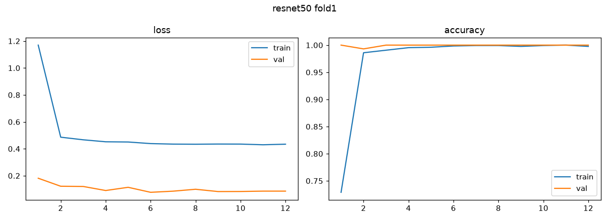

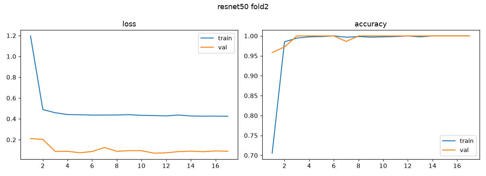

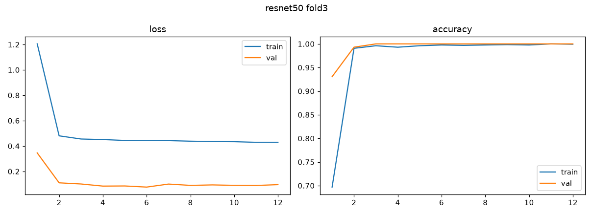

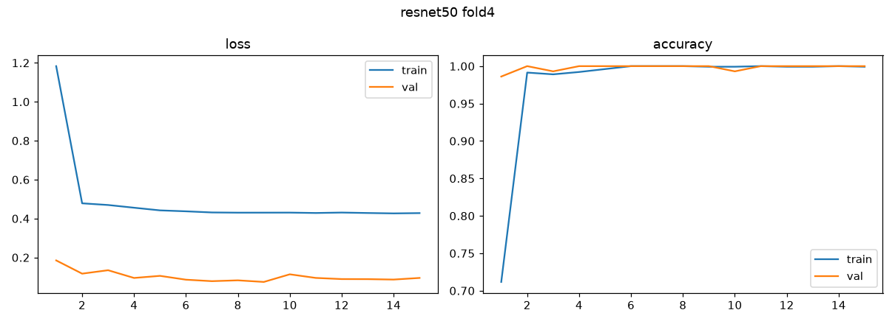

### CNN E003_efficientnet_b0

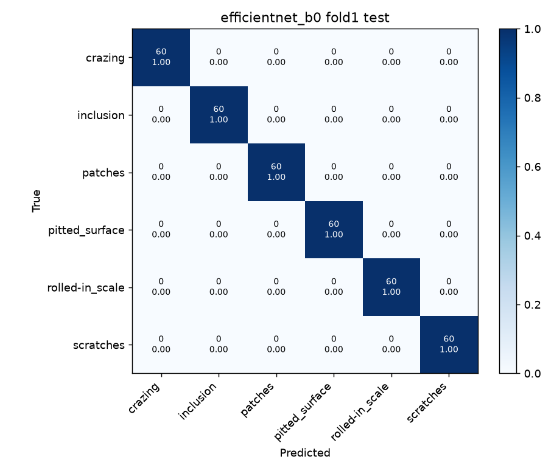
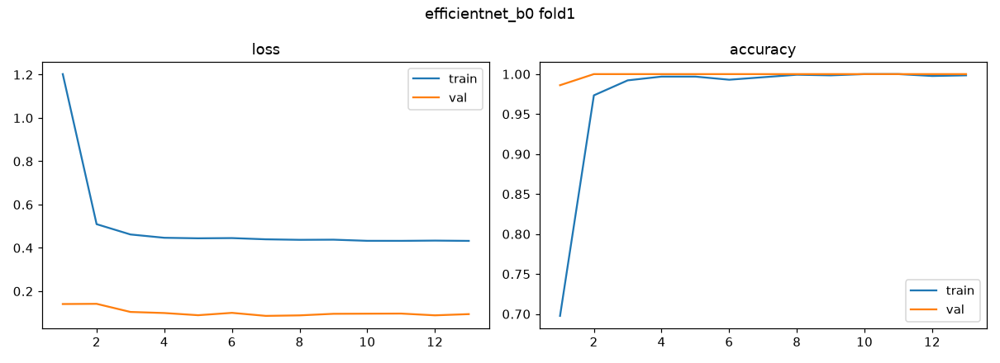

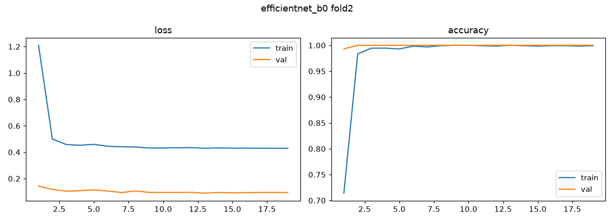

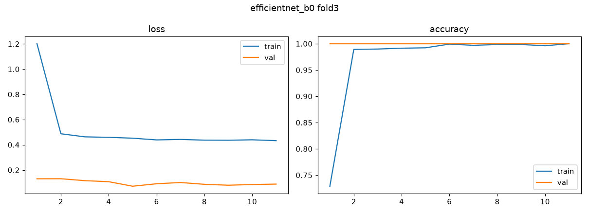

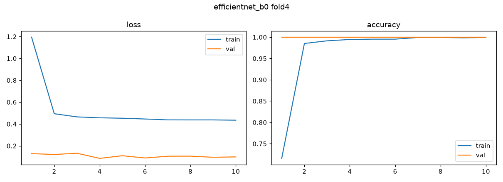

### Grad-CAM

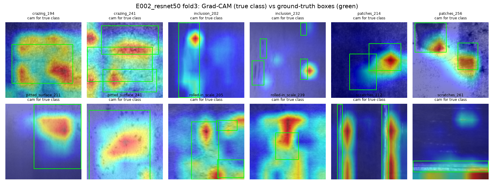
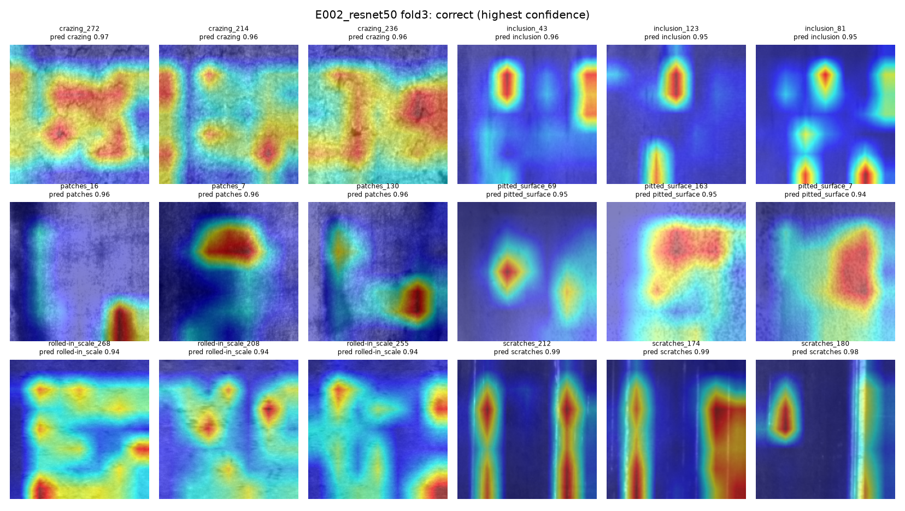
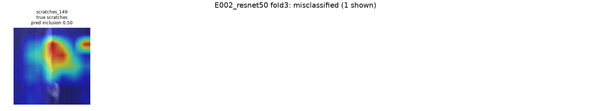

### YOLO E004_yolov8n_fold0

## Observations (OpenCode fills in, Claude reviews)

- ...
